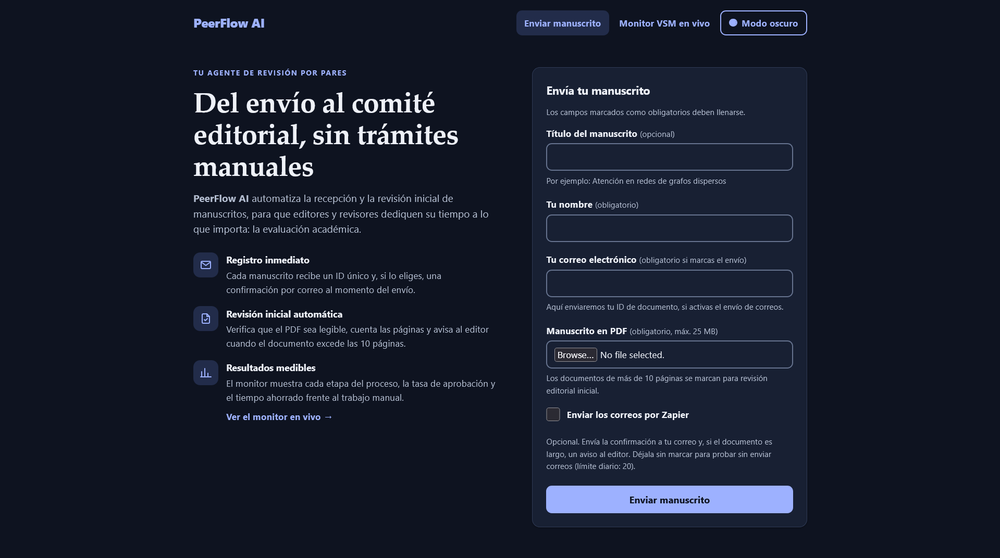
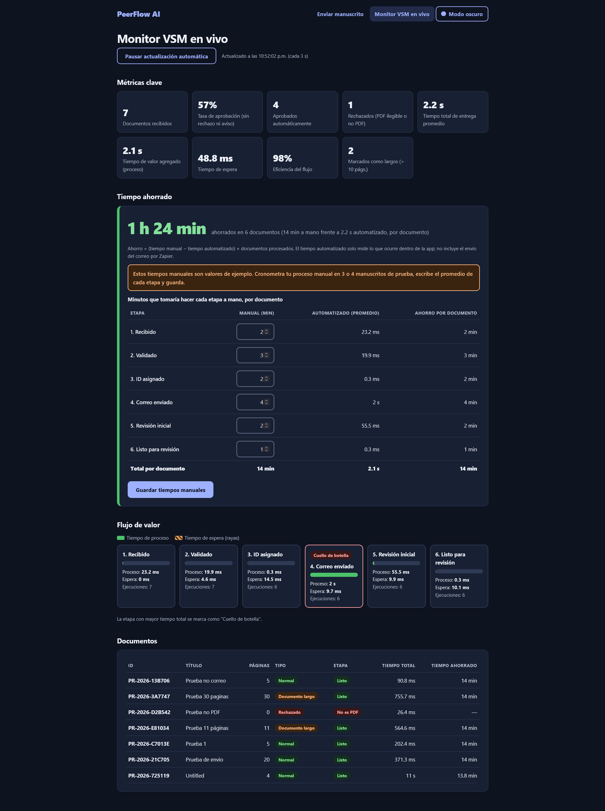

# PeerFlow AI

**Tu agente de revisión por pares.** Prototipo que automatiza la recepción y la revisión inicial de manuscritos
académicos: recibe un PDF, le asigna un ID, confirma por correo, avisa al editor cuando el documento es muy largo y
mide cada etapa con un mapa de flujo de valor (VSM) en vivo.




## Qué hace

1. **Recibe** un manuscrito en PDF desde una página web (nombre, correo y archivo).
2. **Valida** que el PDF sea legible y **cuenta sus páginas**. Los archivos ilegibles o que no son PDF se rechazan y quedan registrados.
3. **Asigna un ID único** (por ejemplo `PR-2026-3D3C14`).
4. **Envía un correo de confirmación** con el ID al autor (a través de un webhook de Zapier). El envío es **opcional**: una casilla
   del formulario lo activa; sin ella el correo solo se simula y no se gasta cuota de Zapier.
5. **Dispara un aviso al editor** si el documento tiene más páginas que el límite configurado (20 por defecto).
6. **Mide el proceso** en el monitor `/tracker`: tiempo por etapa (proceso y espera), cuello de botella, tasa de aprobación (documentos aprobados sin rechazo ni aviso de longitud)
   y **tiempo ahorrado frente al trabajo manual** (los tiempos manuales son editables).

También tiene modo claro/oscuro y está diseñado con criterios de accesibilidad (WCAG 2.2 AA).



## Cómo probarlo

### Opción A: en línea (solo si hay una URL publicada)
Abre: **`AGREGAR AQUÍ LA URL DE RENDER`**

La primera carga puede tardar cerca de un minuto si el servicio estaba inactivo. El envío real de correos es opcional
(casilla "Enviar los correos por Zapier"): déjala sin marcar para probar el flujo, o márcala para comprobar la integración. Sube tus propios PDFs en la página
de inicio y revisa el resultado en **Monitor VSM en vivo**. En la carpeta [`ejemplos/`](ejemplos/) hay dos PDFs de prueba
(5 y 30 páginas).

### Opción B: en tu computadora (por ejemplo, con Spyder)
Requiere Python 3.10 o superior. Descarga el proyecto (**Code > Download ZIP** en GitHub) y descomprímelo.

**Con Spyder:**
1. Abre `app.py` (Archivo > Abrir).
2. En la consola de Spyder instala las dependencias: `%pip install flask pypdf`
3. Presiona **F5** (ejecutar). La consola mostrará `PeerFlow iniciado` y se quedará ocupada: es normal, el servidor está activo.
4. Abre <http://localhost:5000> en tu navegador y sube un PDF.
5. Para detenerlo, presiona el cuadro rojo de la consola. Si al volver a ejecutarlo dice que el puerto está en uso, reinicia el kernel.

**Con la terminal:**

```bash
pip install -r requirements.txt
python app.py
```

Sin configuración adicional el programa funciona en **modo demostración**: la revisión, el ID, las métricas y el aviso de
documento largo funcionan igual, y los correos se imprimen en la consola en lugar de enviarse (aunque marques la casilla de
envío). Para enviar correos reales, ver "Conectar Zapier".

Si el puerto 5000 está ocupado (en macOS suele usarlo AirPlay), cambia `"5000"` por `"5001"` en la última línea de `app.py` y abre
`localhost:5001`.

## Configuración

| Variable | Para qué sirve | Valor por defecto |
|---|---|---|
| `WEBHOOK_URL` | URL "Catch Hook" de Zapier que envía los correos | vacío (modo demostración) |
| `EDITOR_EMAIL` | Correo que recibe el aviso de documentos largos | `editor@example.com` |
| `PAGE_LIMIT` | Páginas a partir de las cuales un documento se marca como largo | `10` |
| `EMAIL_DAILY_LIMIT` | Máximo de correos reales por día (protege la cuota de Zapier) | `20` |
| `REAL_EMAILS_ENABLED` | `0` = nunca enviar correos; solo se simulan | `1` |

- **En tu computadora:** copia `local_settings.example.py` como `local_settings.py` y llena tus datos. Ese archivo está en
  `.gitignore` y no se sube a GitHub.
- **En un servicio de alojamiento:** define las mismas variables como variables de entorno.

Las variables de entorno tienen prioridad sobre `local_settings.py`. **Nunca escribas la URL de Zapier dentro de `app.py` ni
la subas al repositorio**: funciona como una contraseña.

## Conectar Zapier (opcional)

Solo hace falta para enviar correos reales. La URL de Zapier de la autora no está en este repositorio (es privada); crea la tuya:

1. En Zapier: Zap nuevo con el disparador **Webhooks by Zapier > Catch Hook**. Copia la URL que te da.
2. Copia `local_settings.example.py` como `local_settings.py` y escribe ahí tu `WEBHOOK_URL` y tu `EDITOR_EMAIL`.
3. Ejecuta la app, sube un PDF **con la casilla de envío marcada** y, en Zapier, prueba el disparador para que reconozca los datos.
4. Agrega una acción (por ejemplo, **Gmail > Send Email**) con `to`, `subject` y `body` tomados del webhook, y publica el Zap.

## Publicarlo en línea (Render)

GitHub guarda el código, pero no ejecuta aplicaciones Flask. Un servicio como [Render](https://render.com) puede ejecutarlo
desde este repositorio:

1. En Render: **New > Web Service** y conecta este repositorio de GitHub.
2. **Build Command:** `pip install -r requirements.txt`
3. **Start Command:** `gunicorn app:app`
4. En **Environment**, agrega `WEBHOOK_URL` y `EDITOR_EMAIL`.
5. Al terminar el despliegue, Render da una URL pública `onrender.com`. Pégala en la sección "Cómo probarlo".

En el plan gratuito de Render el servicio se apaga tras unos 15 minutos sin visitas, y **los archivos y la base de datos se
borran en cada reinicio**: las métricas y los PDFs subidos no se conservan. Para una demostración es suficiente.
El plan gratuito bloquea el correo directo por SMTP; por eso este proyecto envía los correos mediante un webhook de Zapier.

## Estructura

```
app.py                     servidor Flask, etapas del proceso, correos, API de métricas
templates/                 index.html (inicio), done.html (confirmación), tracker.html (monitor)
static/                    style.css (estilos, modo claro/oscuro) y theme.js (botón de modo oscuro)
ejemplos/                  PDFs de prueba
local_settings.example.py  plantilla de configuración local
```

## Limitaciones conocidas

- Es un prototipo: no tiene inicio de sesión. Cualquiera con la URL puede subir archivos. **No subas documentos confidenciales.**
- Los PDFs subidos se guardan en el servidor mientras este siga activo.
- Los tiempos manuales del cálculo de ahorro son valores de ejemplo hasta que se reemplacen por mediciones propias en el monitor.


## Créditos

Autoría: **Acel Jardon**, curso **Intel IA**.
Desarrollado con la asistencia de Claude (Anthropic).
